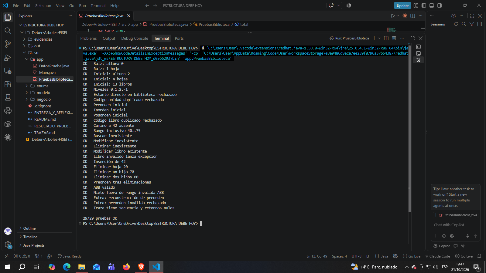

# Catálogo Biblioteca FISEI — Árbol general + ABB

Aplicación Java orientada a objetos. Una biblioteca contiene áreas y estantes (árbol general n-ario); cada estante contiene un ABB de libros por código, con operaciones recursivas.

## Requisitos
Java 17 o superior. Sin bibliotecas externas.

## Compilar y ejecutar desde la carpeta del proyecto

Linux/macOS:
```bash
mkdir -p out
javac -encoding UTF-8 -d out src/enums/*.java src/modelo/*.java src/negocio/*.java src/app/*.java
java -cp out app.PruebasBiblioteca
java -cp out app.Main
```

Windows PowerShell:
```powershell
mkdir out
javac -encoding UTF-8 -d out src/enums/*.java src/modelo/*.java src/negocio/*.java src/app/*.java
java -cp out app.PruebasBiblioteca
java -cp out app.Main
```

En VS Code: abrir esta carpeta con Java Extension Pack; ejecutar `app.PruebasBiblioteca` y luego `app.Main`.

## Clases
- `enums`: tipos de unidad y recorrido.
- `modelo`: Libro y UnidadBiblioteca con validaciones.
- `negocio`: nodos, ArbolBiblioteca y CatalogoABB.
- `app`: carga de ejemplo, menú y 29 pruebas.

## Evidencias pendientes (realizadas por el estudiante)

Se ejecutó la clase PruebasBiblioteca.java para comprobar
el funcionamiento de las estructuras implementadas.

Resultado obtenido: 29/29 pruebas OK.



## Restricciones
Sin colecciones de árboles prediseñadas, sin ordenamientos de lista. Recorridos, búsquedas y operaciones de árboles implementados recursivamente.
