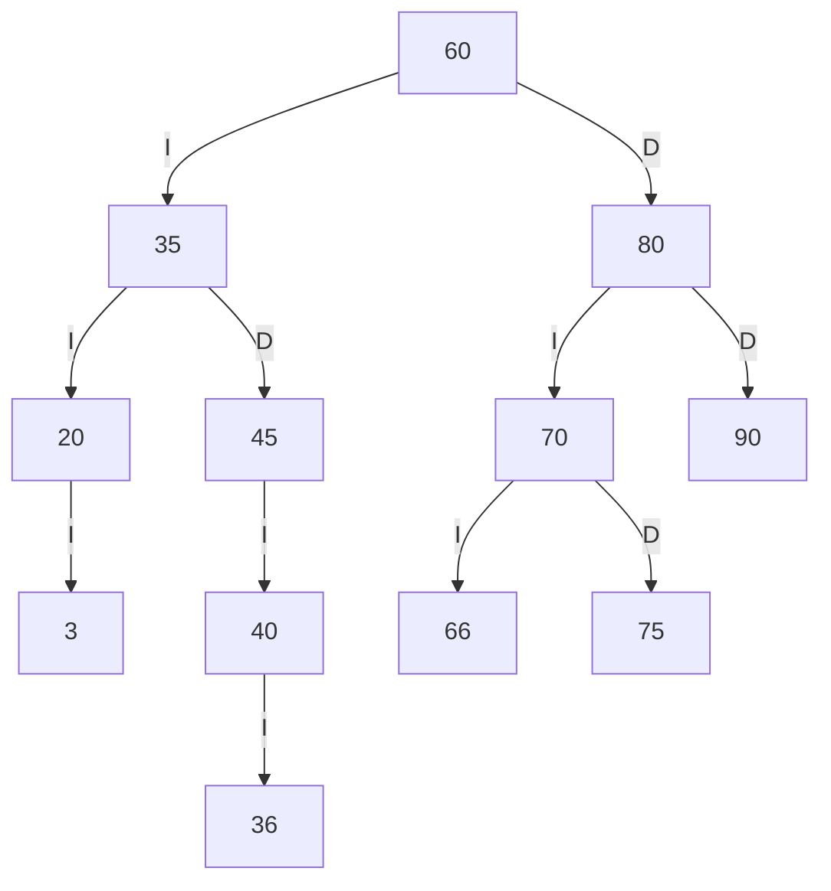
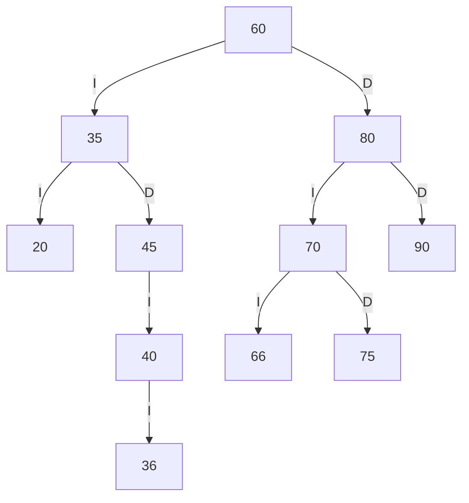
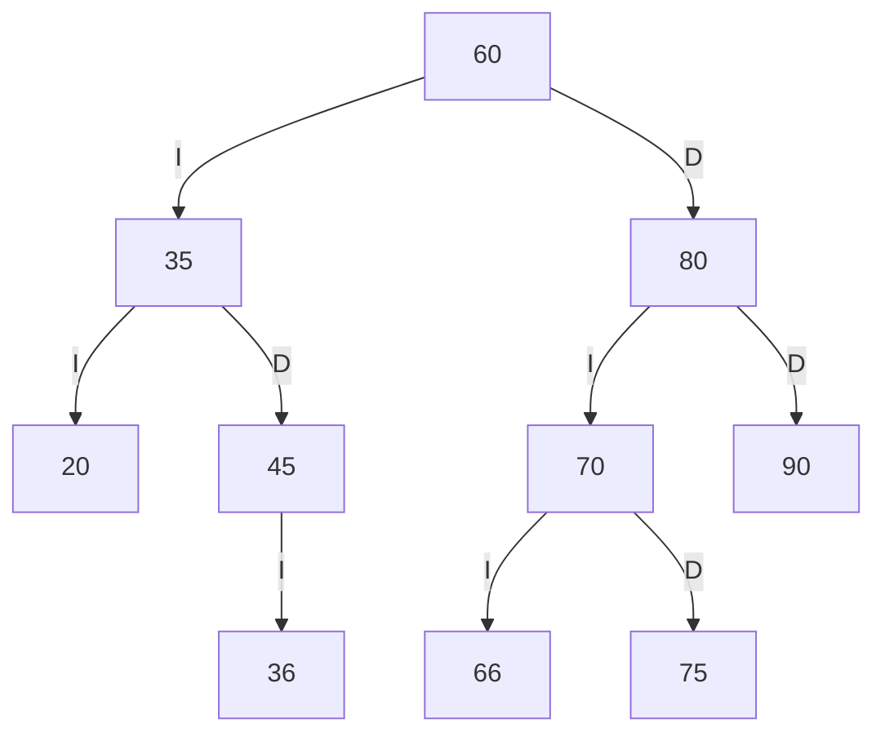
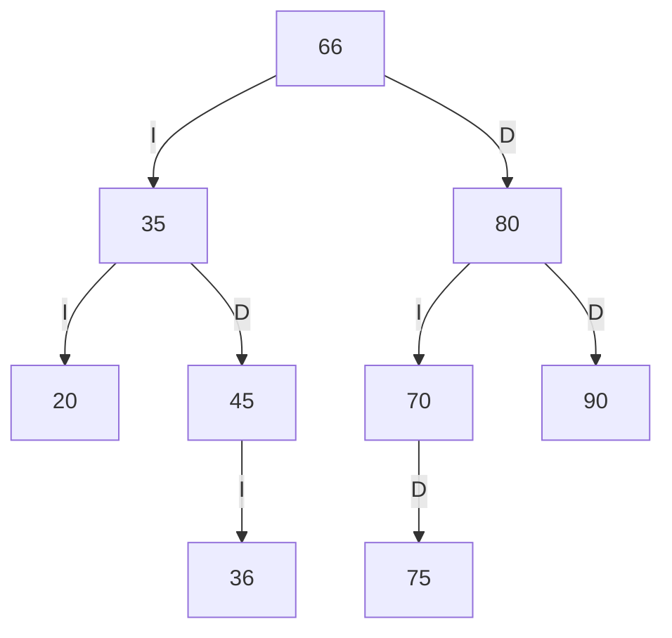

# TRAZAS — Biblioteca FISEI, estante SW-E1

> Códigos personales calculados a partir de los cuatro dígitos proporcionados: **0366**.
> `ab = 03 → 3`, `bc = 36`, `cd = 66`. Ninguno es 0, repetido o coincide con un código inicial.
> Este documento ofrece cálculos y diagramas de referencia; realiza y comprueba personalmente las trazas y añade salidas reales del programa antes de entregar.

## 1. ABB inicial

Orden inicial: `60, 35, 80, 20, 45, 70, 90, 40, 75`.


## 2. Códigos personales y ABB resultante

Inserción completa: `60, 35, 80, 20, 45, 70, 90, 40, 75, 3, 36, 66`.



**Preorden:** `60 35 20 3 45 40 36 80 70 66 75 90`  
**Inorden:** `3 20 35 36 40 45 60 66 70 75 80 90`  
**Posorden:** `3 20 36 40 45 35 66 75 70 90 80 60`  

### Traza completa de preorden

```text
entra 60
VISITA 60
  entra 35
  VISITA 35
    entra 20
    VISITA 20
      entra 3
      VISITA 3
        null -> regresa
        null -> regresa
      null -> regresa
    entra 45
    VISITA 45
      entra 40
      VISITA 40
        entra 36
        VISITA 36
          null -> regresa
          null -> regresa
        null -> regresa
      null -> regresa
  entra 80
  VISITA 80
    entra 70
    VISITA 70
      entra 66
      VISITA 66
        null -> regresa
        null -> regresa
      entra 75
      VISITA 75
        null -> regresa
        null -> regresa
    entra 90
    VISITA 90
      null -> regresa
      null -> regresa
Secuencia PREORDEN: 60 35 20 3 45 40 36 80 70 66 75 90
```

## 3. Eliminaciones sobre el ABB personalizado

Se realizan sucesivamente: **3** (hoja), **40** (un hijo: 36) y **60** (dos hijos; sucesor inorden: 66).

### Eliminar 3 — hoja



**Preorden resultante:** `60 35 20 45 40 36 80 70 66 75 90`

### Eliminar 40 — un hijo



**Preorden resultante:** `60 35 20 45 36 80 70 66 75 90`

### Eliminar 60 — dos hijos



**Preorden resultante:** `66 35 20 45 36 80 70 75 90`

## 4. Comparación con el programa

| Comprobación manual | Resultado esperado | Salida real | ¿Coincide? |
|---|---|---|---|
| Preorden personalizado | `60 35 20 3 45 40 36 80 70 66 75 90` | `60 35 20 3 45 40 36 80 70 66 75 90` | Sí |
| Inorden personalizado | `3 20 35 36 40 45 60 66 70 75 80 90` | `3 20 35 36 40 45 60 66 70 75 80 90` | Sí |
| Posorden personalizado | `3 20 36 40 45 35 66 75 70 90 80 60` | `3 20 36 40 45 35 66 75 70 90 80 60` | Sí |
| Eliminar hoja 3 | `Aplicar y revisar diagrama` | `[OK] Libro eliminado correctamente.` | Sí |
| Eliminar nodo con un hijo 40 | `Aplicar y revisar diagrama` | `[OK] Libro eliminado correctamente.` | Sí |
| Eliminar nodo con dos hijos 60 | `Preorden final: 66 35 20 45 36 80 70 75 90` | `66 35 20 45 36 80 70 75 90` | Sí |

**Importante:** copia o captura las salidas reales de `app.Main` y registra la coincidencia tras comprobarla. No declares coincidencia sin haber ejecutado cada caso.
